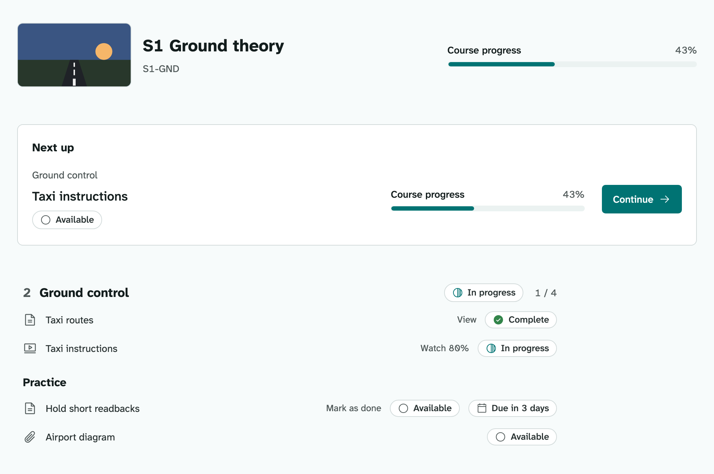
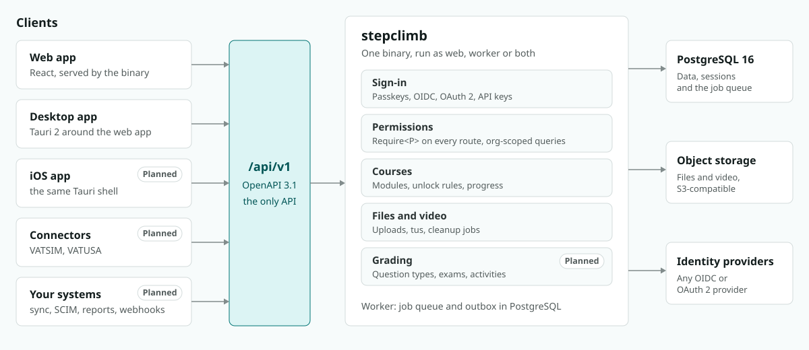

# Stepclimb

Stepclimb is an open-source learning platform for any team that has to train people and prove it:
a company onboarding staff, a club certifying members, a school, or a VATSIM facility. Courses
unlock step by step, and exams and practice games are graded on the server, so results can be
trusted. Training can recur and expire, managers see their own team, and everything can be synced
with, controlled by, or exported to the systems an organization already runs.

<picture>
  <source media="(prefers-color-scheme: dark)" srcset="assets/readme/course-dark.png">
  
</picture>

<sub>The course header, Next up and module row components from Stepclimb UI (<code>packages/ui</code>), captured from their Storybook stories.</sub>

> [!NOTE]
> **Pre-alpha.** Milestone M0 (Foundations) is in progress and specified in
> [`docs/specs/m0/`](docs/specs/README.md). Nothing here is ready to run for real users yet.

## Who it's for

| Organization | Typical use |
| --- | --- |
| Companies and teams | Onboarding, annual compliance training with due dates, reminders and escalation to managers, certificates that expire, audit-ready reports |
| Clubs, volunteer groups and non-profits | Member training and sign-offs, on the free non-profit plan or self-hosted |
| Schools and training providers | Courses, quizzes and exams with item analysis, a gradebook and certificates |
| VATSIM facilities | VATSIM sign-in, VATUSA roster sync, and the ATC pack: flight plan editor game, CRC/ERAM command drills and ATC scenarios |

## What it does

- **Learning:** courses of modules that unlock by prerequisite, with "next up" always visible;
  rich pages, files and video (uploaded or linked, with watch tracking); due dates, reminders and
  escalation; recurring training and completions that expire; certificates with verification
  links.
- **Assessment and practice:** ten question types, versioned banks, random draws, timed exams;
  feedback chosen per quiz or game (full, hint, result only, or none); an activity engine for
  games and simulations; optional packs, starting with the ATC pack.
- **People and access:** passkeys, any OpenID Connect or OAuth 2 provider (SAML later); roles at
  organization, account or course level; user sync, SCIM, and permissions managed by another
  system if wanted.
- **Data and integration:** a reporting API, scheduled exports, signed webhooks, a content API, a
  course archive format, and connectors (VATSIM and VATUSA first) built on the same public API.

## Ways to run it

| Option | Details |
| --- | --- |
| Self-hosted | Free under AGPL-3.0, with every feature included. One binary plus PostgreSQL, with Docker Compose, Helm, or a plain binary. |
| Managed | Hosted by the maintainer, on plans that unlock features and limits, including a free non-profit plan. |
| Apps | An installable web app on any device, plus desktop (macOS, Windows, Linux) and iOS apps built with Tauri. |

## How it fits together

<picture>
  <source media="(prefers-color-scheme: dark)" srcset="assets/readme/architecture-dark.svg">
  
</picture>

## Built with

Versions are the ones pinned in this repository.

| Layer | Tools |
| --- | --- |
| Server | Rust 1.98, axum 0.8.9, tokio 1.54.1, utoipa 5.5.0 (OpenAPI 3.1, served with Scalar) |
| Data | PostgreSQL 16, sqlx 0.9.0, object_store 0.14.2 (S3-compatible storage) |
| Web | React 19.3.1, TanStack Router 1.170.46, TanStack Query 5.105.0, Vite 8.3.5 |
| UI | React Aria Components 1.22.1, Tailwind CSS 4.3.3, design tokens built with Terrazzo, Storybook 10.6.5 |
| Apps | Tauri 2.12.5 |
| Tooling | Node.js 26.13.0, pnpm 12.9.0, a Nix dev shell, just, Playwright 1.64.1, Vitest 5.0.5, Biome 2.6.4 |

Why each of those: [`docs/adr/`](docs/adr/README.md).

## Three things to know before changing anything

1. **There is no hosted CI.** `just ci` on the machine you work on is the merge gate
   ([ADR 0021](docs/adr/0021-no-hosted-ci.md)), and a pull request names the OS it passed on.
2. **The server decides.** Grades, deadlines, unlocks and feedback visibility are decided on the
   server, and every client, the web app included, uses only the public `/api/v1`. An answer that
   reaches a browser before its feedback setting allows is a critical bug.
3. **Every query belongs to one organization.** Repository functions take an `OrgScope`, and every
   protected route checks its permission with `Require<P>`, tested four ways (anonymous,
   missing permission, wrong scope, allowed) plus a cross-organization test.

## Layout

| | |
| --- | --- |
| `crates/` | the server, domain and auth crates; assessment, activities, interop and media as their milestones arrive |
| `migrations/` | SQL migrations, forward-only, embedded in the binary and run at startup |
| `web/` | the React app, built into the binary |
| `apps/app/` | the Tauri 2 shell around `web/` |
| `packages/` | design tokens, the UI library (`@stepclimb/ui`) and the generated API client |
| `deploy/` | the Dockerfile and Compose files, for development and production |
| `docs/` | the plan, the decisions (ADRs) and the feature specs |

[`AGENTS.md`](AGENTS.md) has the full table, the rules every contributor follows (human or agent)
and every command.

## Getting started

```sh
nix develop          # or install the tools listed in AGENTS.md -> Commands
just install-hooks   # once per clone
just up              # PostgreSQL and MinIO in Docker Compose
just serve           # the server on http://127.0.0.1:8080, with the web app built in
just ci              # every gate a pull request must pass
```

Read [`CONTRIBUTING.md`](CONTRIBUTING.md) before opening a pull request.

## Roadmap

| Stage | Contents |
| --- | --- |
| Before 1.0 | Everything above except managed hosting, in milestones M0 to M5. The pilot runs on vZDC's theory training. |
| Managed launch (M6) | Plans, billing, the non-profit program, the operator console. |
| 1.x | SCORM 1.2 and 2004 playback, assignments and rubrics, SAML, LTI, translations, Open Badges, Android, WASM plugins. |

The full plan is in [`docs/plan/`](docs/plan/README.md).

## License

AGPL-3.0-or-later ([`LICENSE`](LICENSE)). The TypeScript API client in `packages/api-client` is
Apache-2.0 ([`packages/api-client/LICENSE`](packages/api-client/LICENSE)) so other systems can
embed it. The diagrams in `assets/readme/` embed Atkinson Hyperlegible Next (SIL Open Font
License 1.1). Security reports: [`SECURITY.md`](SECURITY.md).
