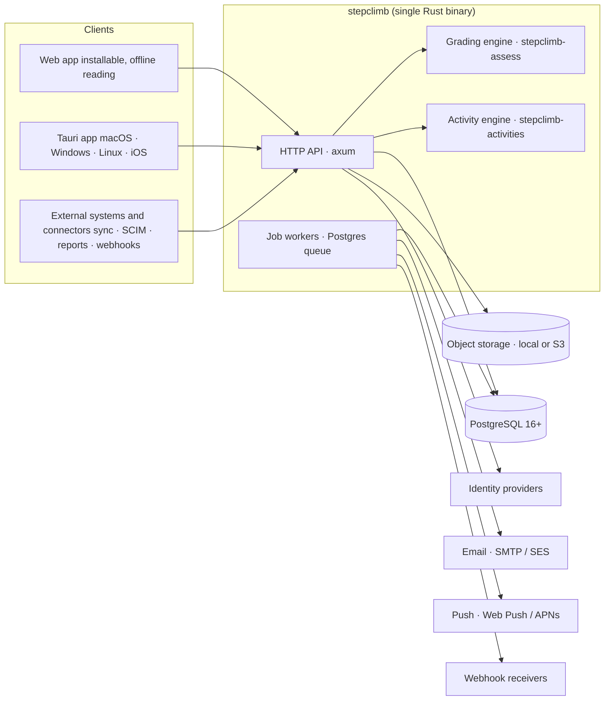
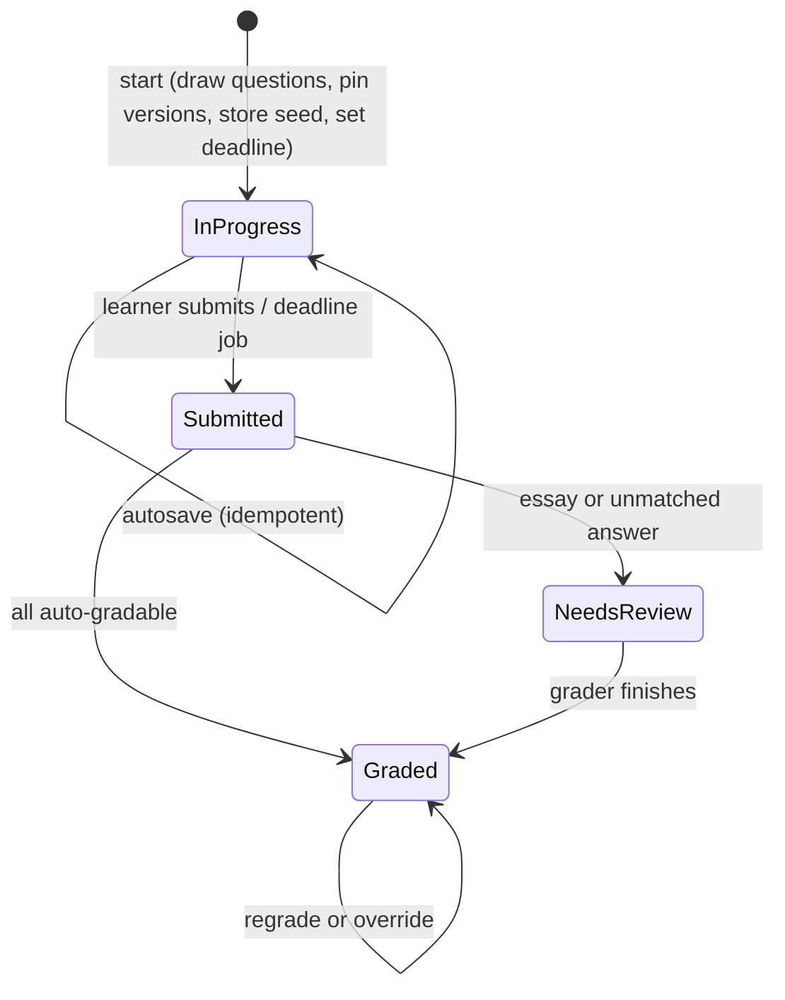

# Technical

The Technical tab of the Stepclimb plan (final plan v1.0, 12 Nov 2026), as Markdown. Source: [the plan artifact](https://claude.ai/artifact/ABMCETKdv4QtXiWhdrJ8VH). Converted for the repository with American spelling (`docs/adr/0020-american-english.md`); the wording is otherwise the plan's. Changes to this file are the owner's (`.claude/rules/research-and-decisions.md`).

## Goals and non-goals

### Goals

- **Clear learner flow:** courses made of modules that unlock by prerequisites, with "what's next" always visible.
- **Training people can prove:** due dates, reminders and escalation, recurring training, completions that expire, managers who see their team, and audit-ready reports.
- **A real assessment engine:** versioned question banks, random draws, a server-enforced timer, manual grading where needed, and per-question statistics.
- **Interactive activities:** a general engine for games and simulations. Packs add domain-specific types, such as the ATC pack's flight plan editor and command drills, with problems generated from rules and data. They give instant feedback, and every step is recorded for trainers.
- **Sign in with anything:** built-in accounts with passkeys, any OpenID Connect provider, any OAuth 2 provider via claim mapping (VATSIM ships as a preset), and SAML later. Admission rules control who gets in.
- **Any organization:** a complete LMS for any team, company or community, self-hosted or hosted for them. Nothing in the core assumes VATSIM or aviation.
- **Integration platform:** other systems can sync users and groups, take over permission management, push content and pull every piece of data through public, documented APIs. Domain-specific integrations such as VATSIM are optional connectors built on those same APIs.
- **Customizable without forking:** theme, logos, domain, terminology, profile fields, email templates and feature flags.
- **Easy to host:** one binary plus PostgreSQL, using under 100 MB of memory when idle.
- **Every platform from one UI:** an installable web app, plus desktop and mobile apps built with Tauri around the same interface.
- **No lock-in:** course export, standard question formats and per-user data export.

### Not in 1.0

- University features: terms, SIS grade passback, plagiarism checking, video conferencing, weighted grade categories.
- SCORM playback (planned for 1.x, and the data model leaves room for it), proctoring, an in-process plugin runtime (WASM plugins come after 1.0).
- An Android app. Tauri can target it, but it isn't scheduled.

Design references are Canvas (module flow) and Moodle (question bank and quiz settings), for UX only. No code is copied or translated from either.

## Architecture and stack



| Layer | Choice |
| --- | --- |
| Server | Rust (2024 edition), axum 0.8, tower-http, tokio |
| Database | PostgreSQL 16+ via sqlx 0.9 with compile-checked queries and a committed `.sqlx/`. Migrations are embedded and run at startup. |
| API docs | utoipa 5 → OpenAPI 3.1, Scalar UI at `/docs`, TypeScript client generated from the spec |
| Jobs | Postgres queue (`FOR UPDATE SKIP LOCKED`) and a transactional outbox. No Redis. |
| Storage | `object_store` crate: local filesystem, S3, R2, MinIO, GCS or Azure |
| Auth libraries | `openidconnect`, `oauth2`, `webauthn-rs`, `argon2`, `samael` (SAML, later) |
| Rich text | Tiptap/ProseMirror JSON as the source, sanitized HTML rendered by the server (`ammonia`) |
| Web | React 19, Vite, TanStack Router and Query, Tailwind 4, Stepclimb UI (see the UI tab), Biome |
| Native apps | Tauri 2 shell around the same web frontend: macOS, Windows, Linux and iOS |
| Grading | `stepclimb-assess`: pure Rust, runs on the server. Also compiled to WASM, used only for authoring previews and ungraded practice. |

```text
stepclimb/
  crates/
    stepclimb-server/     axum app, handlers, config, `stepclimb` binary
    stepclimb-core/       domain types, repos (SQL), permission catalog
    stepclimb-auth/       providers, sessions, OAuth server for Stepclimb's own apps
    stepclimb-assess/     question types, selection, grading (pure, proptest-heavy, also wasm32)
    stepclimb-activities/ activity engine: Activity trait, sessions, event log, mastery rules
    stepclimb-activities-atc/  optional pack: flight plan editor, ERAM/CRC command drills, nav-data loader
    stepclimb-interop/    course archive import/export, CSV; later: GIFT, QTI, LTI, Common Cartridge
    stepclimb-integrations/  sync API, SCIM, permission modes, reports and exports
    stepclimb-connectors/ optional connectors on the public API: vatsim, vatusa
    stepclimb-jobs/       queue, outbox, email, webhooks, push, auto-submit
    stepclimb-media/      tus uploads, ffmpeg transcode to HLS/MP4, posters, captions, signed delivery
  migrations/
  web/                   Vite SPA, embedded into the binary at build time
  apps/app/              Tauri 2 shell (desktop + iOS) around web/
  packages/
    tokens/              design tokens + theme generator
    ui/                  Stepclimb UI component library
    api-client/          generated OpenAPI client (Apache-2.0)
    assess-wasm/         authoring preview / practice grading
  apps/ui-docs/          Storybook for Stepclimb UI
  deploy/                Dockerfile, compose/, helm/stepclimb/
  docs-site/             admin, author, API and self-hosting guides
```

## Tenancy and structure

Every row carries an `org_id`. The default install has one organization and hides the organization switcher. Inside an organization, **accounts** form a tree, like Canvas sub-accounts, each with its own admins and settings.

```text
Organization (vZDC)                       ← identity providers, branding, domain
 └─ Account (root)                        ← admins, roles, defaults
     ├─ Account "Tower"  └─ Course "S1 Ground Theory"
     │                        ├─ Module "Clearance delivery"  → pages, files, quizzes, links
     │                        └─ Module "Ground control"      (requires previous module)
     └─ Account "Enroute" └─ Course "Center Fundamentals"
```

- Every repo function takes an `OrgScope`, and a test suite attempts cross-organization access on every route.
- **Reporting lines:** each user can have a manager, set in the UI or through sync (`manager_external_id`). The built-in **Manager** role is scoped to a user's direct and indirect reports. Managers see progress, due dates and overdue items, and receive escalations.
- Groups come from sign-in claims, the sync API, SCIM, connectors, the admission webhook or admins, and drive automatic enrollment.

## Identity and access

### Sign-in providers

| Type | Details | When |
| --- | --- | --- |
| Local accounts | Email plus passkey first. Password (argon2id) and TOTP as fallback. Optional magic link. Each can be switched off per organization. | 1.0 |
| OpenID Connect | Discovery, PKCE, ID token validation (Google, Entra, Authentik, Keycloak and others) | 1.0 |
| Generic OAuth 2 | Authorize, token and userinfo URLs, with attributes read through JSON Pointer mappings. VATSIM Connect ships as a preset. | 1.0 |
| SAML 2.0 | SP metadata, signed assertions, attribute mapping | 1.x |

```toml
[[providers]]
kind = "oauth2"   key = "vatsim"   label = "Sign in with VATSIM"
authorize = "https://auth.vatsim.net/oauth/authorize"
token     = "https://auth.vatsim.net/oauth/token"
userinfo  = "https://auth.vatsim.net/api/user"
scopes    = ["full_name", "vatsim_details", "email"]
[providers.claims]
subject = "/data/cid"   given_name = "/data/personal/name_first"   family_name = "/data/personal/name_last"
email   = "/data/personal/email"
attributes.rating = "/data/vatsim/rating/short"   attributes.subdivision = "/data/vatsim/subdivision/id"
```

Identities are stored as `(provider, subject)`, so a person can link more than one. Matching accounts by email is off by default, which prevents takeovers through another provider.

### Admission

1. A known identity loads the user. Suspended users are refused.
2. Declarative rules run on the mapped attributes.
3. Optional **sync-only mode**: only users already provisioned (by the sync API, SCIM, a connector or an admin) may sign in.
4. An optional **admission webhook** receives a signed POST of `{provider, subject, attributes}` and replies `{allow, groups[], attributes{}}`. Timeout is 3 s and the default on failure is to refuse.
5. A new user is created just-in-time only if the organization allows sign-up. Otherwise they must already exist through sync or an admin.

### Sessions and tokens

- **Browser:** an `__Host-sc_session` cookie (HttpOnly, Secure, Lax) holding a random token, stored hashed. Sessions expire after 12 hours idle and 30 days at most. CSRF protection through Fetch Metadata and an Origin allowlist.
- **Stepclimb's own apps:** Stepclimb acts as an OAuth 2.1 server for its Tauri app. Sign-in uses PKCE in the system browser, returning to the app through a deep link. Access tokens last 15 minutes; refresh tokens rotate, are reuse-detected and are stored in the OS keychain.
- **Machines:** service accounts and API keys in the format `sc_<random>_<crc32>`, stored hashed. A key's effective rights are its scopes intersected with the owner's current permissions.

### Permissions and roles

Permissions are a fixed catalog defined in code. Roles bundle permissions and are granted at organization, account or course scope, and orgs can build custom roles. Handlers use typed extractors such as `Require<perm::CourseContentEdit>`. Every protected route is tested four ways: anonymous gets 401, missing permission 403, wrong scope 404, allowed 2xx.

| Built-in role | Can | vZDC mapping |
| --- | --- | --- |
| Organization admin | Everything, including providers, branding and integrations | WM, ATM |
| Account admin | Courses, users, roles and reports within an account subtree | TA, DATM |
| Course designer | Edit content, banks and quizzes | TA, assigned instructors |
| Instructor | Designer permissions plus grading, overrides, accommodations and enrollments | INS |
| Grader | Grade submissions and give feedback | MTR |
| Student | Take enrolled courses | Enrolled controllers |
| Manager | See and remind their own reports, receive escalations | (not used) |
| Observer | Read-only view of named students' progress | Staff oversight |

### Provisioning

- **Every user, group and role assignment records its source:** local, identity provider, sync API, SCIM or a connector, with an optional `external_id`. Records owned by an external source are read-only in the UI, so the two never fight.
- **Ways in:** admin invites, CSV import, self sign-up (if enabled), the sync API, SCIM 2.0 and connectors. See Integration platform.
- **Enrollment rules:** group G → course C as role R. When someone leaves the group, the enrollment is either concluded (history kept) or deleted, depending on the rule.

## Courses and content

| Concept | Behavior |
| --- | --- |
| Course | Title, code, cover, status (draft, published, archived), dates, home page. Can be copied, including as a template. |
| Module | Ordered items, unlock date, prerequisite modules, optional sequential completion, completion rule |
| Item | Page, Video, File, Quiz, Activity, External link or Header (Assignment and LTI come in 1.x). Requirement: view, mark done, watch ≥ X%, submit, score ≥ X, or an activity's mastery rule. |
| Video | Two sources, one player and the same tracking: • **Uploaded:** resumable uploads (tus) up to a plan or instance limit. A transcode job (ffmpeg) produces HLS at 360p, 720p and 1080p in H.264/AAC, plus a poster image, a thumbnail strip and an MP4 for offline download. Stored through `object_store` and served through short-lived signed URLs, so files can't be hot-linked. Captions are WebVTT, uploaded per language. Chapters are set in the editor. • **Linked:** YouTube and Vimeo through their player APIs, plus other providers through oEmbed and direct MP4 or HLS URLs. Watched segments are recorded for both, so skipping ahead doesn't count. Watch data goes to the trainer view, and the Tauri app can download uploaded videos for offline viewing. |
| Page | Versioned Tiptap JSON: headings, callouts, tables, code, images, YouTube or Vimeo embeds, phraseology blocks, ungraded "check your understanding" questions |
| File | Stored once per unique file (SHA-256) in per-course folders. Served through short-lived signed URLs with an inline PDF preview. |
| Announcement | Course- or account-wide. Sent by email and push according to each user's preferences. |

Progress is stored per user and item and rolled up to module and course when it changes. Each change emits `item.completed`, `module.completed` or `course.completed`.

## Assessments

| Question type | Grading | ATC example |
| --- | --- | --- |
| Single choice | Auto, choices shuffled per attempt | Which runway configuration applies when… |
| Multiple response | Auto: all-or-nothing, partial, or right-minus-wrong | Select every element of an IFR clearance |
| True / false | Auto | Mode C veil requirements |
| Matching | Auto, partial credit per pair | Match fixes to STARs |
| Ordering | Auto, exact order or longest correct run | Order the CRAFT elements |
| Short answer | Auto with alternative answers and optional regex. Unmatched answers go to a review queue. | Ground frequency at IAD |
| Numeric | Auto: exact, ± tolerance or range | MVA in a sector |
| Cloze | Auto per blank (dropdown, text or number) | Clearance readback |
| Hotspot | Auto, using regions on an image | Click the SFRA boundary |
| Essay | Manual, optionally with a rubric | Explain an arrival sequence |

```rust
pub trait QuestionType {
    type Definition: Serialize + DeserializeOwned + Validate;  // stored in question_versions.body
    type Response:   Serialize + DeserializeOwned;              // what the client submits
    type Render:     Serialize;                                  // what the client sees, never contains answers
    fn render(def: &Self::Definition, seed: u64) -> Self::Render;
    fn grade(def: &Self::Definition, r: &Self::Response, seed: u64) -> Grade;
    fn needs_manual(def: &Self::Definition, g: &Grade) -> bool;
}
```

- **Grading runs only on the server.** Answer keys never reach a client before the review policy allows it. The WASM build of `stepclimb-assess` is used only for instructors' authoring previews and for ungraded practice questions, where the answers aren't secret.
- **Banks:** belong to an account or course and can be shared down the tree. Questions are tagged and versioned, and attempts pin the exact version shown. When a key is corrected, affected attempts can be regraded in one action, with an audit trail. Bulk entry through a spreadsheet (CSV) template.
- **Quiz settings:** fixed questions and/or pools ("draw N from bank B with tags T"), shuffling, open and close times, access code, time limit with server auto-submit, maximum attempts, cooldown, which score counts, pass mark, feedback settings (see Feedback settings), and per-user accommodations (extra time or attempts).



The deadline is stored on the server and the client only displays a countdown. Answers autosave with idempotency keys. If the connection drops, answers queue on the device, and only those saved before the deadline count. Statistics: facility and discrimination per question, distractor rates and score distribution, all exportable as CSV.

## Interactive activities

An **activity** is a game or simulation placed in a module like any other item. The server generates every problem from rules and data, and checks every answer. The student gets feedback after each step, and every step is recorded for trainers.

### Requirements

- **Repeatable:** unlimited new problems from a seed, so no two runs are the same, and any problem can be reproduced exactly from its seed and data version.
- **Always correct:** answers come from rules, not hand-typed keys. Each generated problem is validated before it's served, and the checker accepts any valid answer, not just one expected string.
- **Instant feedback, when allowed:** each answer is checked on the server in under 100 ms (p95). How much the student is told depends on the activity's feedback settings (below).
- **Fully recorded:** every action, result, feedback and timestamp, plus active time spent.

```rust
pub trait Activity {
    type Params:   Serialize + DeserializeOwned + Validate;   // set by the course designer
    type Problem:  Serialize;                                  // sent to the client, never contains the solution
    type Solution;                                             // stays on the server
    type Action:   DeserializeOwned;                           // one student step
    fn generate(p: &Self::Params, data: &DataSets, rng: &mut Seeded) -> Result<(Self::Problem, Self::Solution)>;
    fn validate(pr: &Self::Problem, s: &Self::Solution, data: &DataSets) -> Result<()>;   // self-check before serving
    fn check(pr: &Self::Problem, s: &Self::Solution, a: &Self::Action, data: &DataSets) -> Step;
}
pub struct Step { pub correct: bool, pub done: bool, pub feedback: Vec<Feedback> }   // Feedback = rule id + message + field
```

### Activity types

| Type | How it works | When |
| --- | --- | --- |
| Drill games: matching, fill-in-the-blank, ordering | Rounds drawn from question banks, with streaks and an optional round timer. Every answer is checked as it's given. Built in for all organizations. | M3 |
| Daily review | Spaced repetition (FSRS) over any question bank. Each student gets a short daily set, with each question scheduled for just before they'd forget it. Retention per topic shows in the trainer view. Built in for all organizations. | M3 |
| Rule-checked form | The generic engine behind the flight plan editor: fill in or fix a form until it passes rules defined in data, with feedback per field. Organizations can use it for things like incident reports or work orders. Built in for all organizations. | M3 |
| Flight plan editor | The generator picks a realistic flight from navigation data and the facility's airports, then adds 0–3 errors from a catalog: altitude wrong for direction or LOA, route not matching the preferred route, invalid fix or airway join, wrong equipment suffix, SID or STAR invalid for the airport, missing fields. The student fixes it in a scope-style flight plan editor. The final plan is checked against every rule, so any legal fix is accepted, and feedback is given per field. | M3 |
| Branching scenario | A generic, authored "what would you do?" simulation: situation → choices → consequences, with scoring per path, optional time pressure and media on each step. Built with a visual graph editor. Built in for all organizations. | M5 |
| ATC scenario (ATC pack) | The branching engine adapted for VATSIM training. Each step shows a traffic picture (a scope-style map with targets and data blocks) and a pilot transmission as text, with optional audio. The student either picks a response or types it in phraseology, which a phraseology grammar from vZDC's data sets checks for content and order. Scenarios can reference SOP and LOA sections, so feedback cites the exact rule. | M5 |
| Runway heading (ATC pack) | The student gets an aircraft with its full flight plan and the runway it's holding short of, and gives the initial heading to assign. The answer is checked against vZDC's departure heading table (runway configuration × departure gate or first fix × aircraft type where it applies), and feedback names the gate and the rule. Two modes: **practice** (no clock, explained feedback) and **sprint** (see below). | M3 |
| Clearance builder (ATC pack) | Given a filed flight plan, the student types the full IFR clearance (CRAFT) with the correct SID, altitude, frequency and squawk. The phraseology grammar checks content and order. | M5 |
| Readback catcher (ATC pack) | A pilot reads back a clearance, as text or audio, and the student spots and corrects the error. | M5 |
| METAR to runway configuration (ATC pack) | From a real or generated METAR, the student picks the runway configuration vZDC's SOP calls for and composes the ATIS. Wind components and SOP rules are checked. | M5 |
| ERAM/CRC command drill | The only enroute game: live control practice belongs in the real tools. The student gets a situation and types the command. A grammar defined in data parses it, and the checker compares meaning (aircraft, field, value) rather than exact text, so equivalent forms are accepted. Feedback explains syntax errors. | 1.0 |

### Sprint mode

Any generated activity can be played as a sprint: a fixed time (for example 2 minutes) or a fixed number of problems, scored on both accuracy and speed. Each correct answer earns points that decay with response time, and wrong answers cost points and break the streak. Students see their personal bests and a trend over time. An organization can turn on leaderboards, and students can opt out. Trainers see sprint results alongside practice. Sprint feedback defaults to "result only" so the pace stays high, with a full review at the end.

### Out of scope

Live control simulation (vectoring to final, arrival merging, conflict resolution, reroutes, handoffs) is practiced in the real ATC tools during actual training, not in Stepclimb. The ATC pack covers knowledge and procedure: flight plans, headings, clearances, phraseology and commands.

The ATC activities form the `stepclimb-activities-atc` pack. It's compiled in behind a cargo feature and enabled per organization, so any VATSIM facility can use it, not just vZDC. The visuals are our own drawings in the style of a radar scope. No vNAS assets are used, and command syntax comes from vNAS's public documentation.

### Feedback settings (quizzes and activities)

Every quiz and activity has two settings, chosen by the designer and overridable per student or group. Both are enforced by the server: the API only returns what the setting allows, so hidden information never reaches the device.

| During the attempt | The student sees after each answer | Typical use |
| --- | --- | --- |
| Full | Correct or incorrect, which rule was broken and why, and the correct answer, with a link to the lesson | Practice games, self-checks |
| Hint | Correct or incorrect plus the explanation, but not the answer, so the student can try again | Guided practice |
| Result only | Correct or incorrect, nothing more | Quizzes, progress checks |
| None | "Answer saved" only | Tests and exams |

| After submitting | The student sees |
| --- | --- |
| Nothing | That it was submitted |
| Score | Total score and pass or fail |
| Right / wrong | Score plus which questions or problems were right or wrong |
| Full review | Their answers, the correct answers and the explanations |

- **When it's released:** immediately, after the close date, or manually by staff. For example, an exam can show its score now and a full review only after everyone has sat it.
- **Presets:** Practice (Full / Full review), Quiz (Result only / Right / wrong), Exam (None / Score, full review released manually). Designers can pick a preset or set each option.
- **Test mode for activities:** a fixed number of problems, an optional time limit and attempt limit, and usually feedback set to None. Problems are still generated, but drawn at a set difficulty so every student gets an equivalent test.
- **Trainers always see everything,** whatever the student-facing setting: every answer, whether it was right, the explanation and the time spent.

### Data and correctness

- **Navigation data:** the FAA's NASR (28-day cycle) and CIFP data, both public domain, loaded by a job each AIRAC cycle.
- **Organization data sets:** preferred routes, LOA altitude rules, departure heading tables, runway configurations, phraseology and command grammars, uploaded as CSV or YAML. They're validated on upload, versioned, and edited by the training staff.
- **Every session records** its activity version, data versions and seed, so any problem can be replayed exactly.
- **Known-case library:** YAML cases (input → expected verdict) written with the TA. They run in CI and whenever a data set changes. A failing case blocks publishing the data.
- **"This looks wrong" button:** sends the exact problem and answer to staff. After a rule is fixed, recorded sessions can be re-checked against it, and affected results are updated, with an audit entry.

### What trainers see

- **Per student:** sessions, active time, number of problems, accuracy, mastery status, and a breakdown by error type (for example "70% of misses are altitude for direction").
- **Session replay:** each problem, every step the student took, and the feedback they got.
- **Across students:** the most common mistakes per activity, to guide teaching. Everything exports as CSV.
- **Active time** counts only while the tab is visible and the student has interacted in the last 60 s. The client sends a heartbeat every 15 s, capped by server timestamps.
- **Mastery rules:** N correct in a row, ≥ X% over the last N problems, N rounds complete, or a timed-round score ≥ X. Reaching mastery completes the item and emits `activity.mastered`.

## Progress and grades

- **Gradebook:** one column per graded item, overrides, comments and CSV export. Points only, no weighted categories.
- **Progress views:** a learner dashboard across courses, an instructor roster heat map and per-student timelines.
- **Certificates:** a completion PDF with a verification URL, showing an expiry date where one applies. Open Badges 3.0 comes in 1.x.

### Due dates, recurrence and expiry

- **Assignments:** a course, module or item assigned to people or groups, with a due date that is either fixed or relative ("within 14 days of joining"). Enrollment rules can create assignments automatically.
- **Reminders and escalation:** rules per assignment, for example "remind 7 and 1 days before, then on the due date; if overdue 3 days, email their manager". Sent by the jobs queue, and visible on a timeline.
- **Recurrence:** a course can recur ("every 12 months" or "every January"). Each cycle is a new assignment, and history is kept per cycle.
- **Expiry:** completions can expire after a set time. An expired completion re-locks anything that depends on it and triggers the next cycle.
- **Compliance report:** per course and group, showing who is compliant, due soon, overdue or expired. It can be exported, scheduled to managers, and pulled through the reporting API.

## Integration platform

Stepclimb is complete on its own: a company with no other systems can run everything from the admin UI. Anything an outside system might need is a public, versioned API. Every client, including Stepclimb's own apps, uses the same API, with no private endpoints. Old API versions are kept at least 12 months after a breaking change.

| Capability | How | When |
| --- | --- | --- |
| Sign-in | Local accounts, any OIDC provider, any OAuth 2 provider via claim mapping, SAML later. See Identity and access. | M0 |
| User and group sync | `PUT /api/v1/sync/users` and `/sync/groups`: idempotent bulk upsert keyed by `external_id`. `mode=full` suspends anyone missing from the payload, and `mode=partial` only adds and updates. Each run is logged with counts and errors. Identity providers (Entra, Okta, Google) can use **SCIM 2.0** instead. | M4 |
| Permission management | Each organization picks where role assignments come from: • **Managed in Stepclimb** (default): admins assign roles in the UI. • **Group-mapped:** rules map external groups (from sign-in claims, sync, SCIM or a connector) to a role at a scope, for example "group `instructors` → Instructor on account Tower". Mapped assignments are read-only in the UI. • **Pushed:** the external system sets assignments directly through `PUT /api/v1/sync/role-assignments`. • **Delegated:** Stepclimb calls the organization's authorization endpoint at sign-in and every N minutes, and gets back `{roles: [{role, scope}]}`. Results are cached, and if the endpoint fails Stepclimb refuses access after a configurable grace period. The external system decides *who* holds which role. What each role is allowed to do comes from Stepclimb's permission catalog, and custom roles can be defined through the API. | M4 |
| Data out | • **Reporting API:** `/api/v1/reports/{enrollments\|completions\|attempts\|responses\|activity-sessions\|activity-steps\|video-progress}`, with filters and an `updated_since` cursor for incremental sync into a data warehouse. • **Bulk exports:** background jobs that produce CSV or NDJSON, either downloaded or delivered on a schedule to the organization's own S3-compatible bucket. • **Read-only scoped API keys** (such as `reports:read`) for BI tools and admin scripts. | M4 |
| Events | [Standard Webhooks](https://www.standardwebhooks.com/) (HMAC signed), sent from the outbox with exponential backoff for 24 h, with a delivery log and replay. Events: `user.created\|updated\|suspended`, `enrollment.created\|concluded`, `item\|module\|course.completed`, `attempt.submitted\|graded`, `activity.session.completed`, `activity.mastered`, `grade.overridden`, `certificate.issued`. | M4 |
| Content in | A content API for courses, modules, pages, questions, activities and data sets, so content can be managed or generated from other systems. Also course archive import and CSV question import. | M1–M4 |
| Embedding | Deep links (`/c/:course/m/:module/i/:item`) with an optional return URL, so a host site can send people straight to an item. | M1 |
| Connectors | Packaged, optional integrations, enabled per organization, that use *only* the public APIs above. They run inside the binary as jobs, or as separate services with the same contract. The first two are **VATSIM Connect** (a sign-in preset) and **VATUSA** (facility home and visiting rosters synced as users and groups, with facility roles group-mapped to Stepclimb roles). Others can follow later, such as Google Workspace or Discord notifications. | M4 |
| Standards (1.x, only if needed) | LTI 1.3, QTI 3.0, Common Cartridge, GIFT and Moodle XML import, xAPI export. These never constrain Stepclimb's own data model. | 1.x |
| Plugins | WASM plugins running in wasmtime against a versioned WIT interface: custom question and activity types, admission and enrollment rules, reports. | after 1.0 |

## Data model (core tables)

```sql
-- identity                                             (uuid v7 keys, created_at/updated_at everywhere)
organizations(id, slug, name, settings, branding)        accounts(id, org_id, parent_id, name, path ltree, settings)
users(id, org_id, external_id?, source, manager_id?, display_name, given_name, family_name, email?, status, profile, locale, tz)
identity_providers(id, org_id, key, kind, config, enabled)   identities(id, user_id, provider_id, subject, attributes)
passkeys(id, user_id, credential, name)   sessions(id, user_id, token_hash, kind, last_seen_at, expires_at)
oauth_refresh_tokens(id, client_id, user_id, token_hash, family_id, rotated_from, expires_at)
service_accounts(id, org_id, kind, owner_user_id?, secret_hash, scopes)
groups(id, org_id, key, name, source)   group_members(group_id, user_id, source)
-- access
roles(id, org_id?, key, builtin, permissions[])   role_assignments(user_id, role_id, scope_type, scope_id, source)
group_role_mappings(id, org_id, group_id, role_id, scope_type, scope_id)   authz_settings(org_id, mode, endpoint?, refresh_s, grace_s)
enrollment_rules(id, org_id, group_id, course_id, role_id, on_remove)
assignments(id, org_id, target_type, target_id, assignee_type, assignee_id, due_fixed?, due_relative?, recurrence?, reminder_rule, cycle)
completions(id, user_id, target_type, target_id, cycle, completed_at, expires_at?)   reminders_sent(assignment_id, user_id, kind, at)
-- learning
courses(id, org_id, account_id, code, title, status, settings)   enrollments(id, course_id, user_id, role_id, status, source)
modules(id, course_id, position, title, unlock_at, require_sequential, completion_rule)   module_prerequisites(module_id, requires_id)
module_items(id, module_id, position, kind, ref_id, title, requirement)
pages(id, course_id, slug, title, current_version_id)   page_versions(id, page_id, body, author_id)
files(id, org_id, sha256, size, mime, storage_key)   course_files(course_id, file_id, folder, name)
videos(id, org_id, source ['upload','youtube','vimeo','oembed','url'], file_id?, url?, status, duration_s, renditions jsonb, poster_key?)
video_captions(video_id, lang, file_id)   video_chapters(video_id, at_s, title)
item_progress(user_id, item_id, state, score?, completed_at)   module_progress / course_progress
-- assessment
question_banks(id, org_id, owner_type, owner_id, title)   questions(id, bank_id, current_version_id, tags[], difficulty)
question_versions(id, question_id, qtype, body, points, author_id)            -- immutable
quizzes(id, course_id, title, settings)   quiz_slots(id, quiz_id, position, kind, question_id?, bank_id?, tag_filter[], draw, points)
quiz_overrides(id, quiz_id, user_id?, group_id?, settings)
attempts(id, quiz_id, user_id, number, seed, state, started_at, deadline_at, submitted_at, score, max_score)
attempt_questions(attempt_id, position, question_version_id, points, render_seed)
responses(attempt_id, position, body, saved_at, idem_key, auto_score, manual_score, grader_id, feedback)
-- activities
activities(id, course_id, kind, version, params, mastery_rule)   data_sets(id, org_id, kind, version, body, published_at)
activity_sessions(id, activity_id, user_id, activity_version, data_versions jsonb, seed, started_at, ended_at, active_ms, problems, correct, mastered)
activity_problems(session_id, index, problem, solution, validated_at)
activity_steps(session_id, problem_index, seq, action, correct, feedback, at, idem_key)
activity_flags(id, session_id, problem_index, user_id, note, status)
video_progress(user_id, item_id, watched_ranges int4multirange, duration_s, percent)
-- platform
outbox(id, org_id, topic, payload, dispatched_at)   jobs(id, queue, payload, run_at, attempts, locked_until, last_error)
plans(id, key, features jsonb, limits jsonb)   org_plans(org_id, plan_id, source ['stripe','grant','nonprofit','selfhost'], ends_at?, stripe_sub?)
email_senders(org_id, kind ['domain','smtp'], config, verified_at)
connectors(id, org_id, kind, config, enabled, last_run_at)   sync_runs(id, org_id, source, kind, mode, stats, errors, at)
export_jobs(id, org_id, report, format, filter, destination, status, url, schedule?)
webhook_endpoints(id, org_id, url, secret, events[])   webhook_deliveries(id, endpoint_id, event_id, status, attempt, next_at)
audit_events(id, org_id, actor, action, target_type, target_id, data, at, ip)
notifications(id, user_id, kind, payload, read_at)   push_subscriptions(id, user_id, kind ['webpush','apns'], endpoint_or_token)
```

## API surface (v1 highlights)

| Endpoint | Purpose |
| --- | --- |
| `GET /api/v1/me`, `/me/dashboard` | Current user, permissions, courses, next-up items |
| `/auth/{provider}/start\|callback`, `POST /oauth/token\|revoke` | Browser sign-in; app tokens (PKCE, refresh rotation) |
| `/api/v1/courses`, `/courses/{id}/modules`, `/modules/{id}/items` | Course structure and reordering |
| `/api/v1/pages/{id}`, `/pages/{id}/versions`, `POST /items/{id}/progress` | Content, history, progress |
| `/api/v1/banks`, `/banks/{id}/questions`, `POST /banks/{id}/import` | Banks, questions, CSV import |
| `POST /quizzes/{id}/attempts`, `PUT /attempts/{id}/responses/{pos}`, `POST /attempts/{id}/submit`, `GET /attempts/{id}/review` | Attempt lifecycle (autosave needs an `Idempotency-Key`) |
| `POST /activities/{id}/sessions`, `POST /activity-sessions/{id}/steps`, `POST /activity-sessions/{id}/heartbeat`, `POST /activity-sessions/{id}/flags` | Start a run, check a step (needs an `Idempotency-Key`), track active time, report a problem |
| `/courses/{id}/activity-report`, `/activity-sessions/{id}/replay`, `/admin/data-sets` | Trainer view and replay, organization data sets |
| `/courses/{id}/grading-queue`, `/gradebook`, `/stats` | Instructor tools |
| `/api/v1/admin/providers\|roles\|groups\|enrollment-rules\|webhooks\|branding` | Administration |
| `PUT /api/v1/sync/users\|groups\|role-assignments`, `/scim/v2/*`, `/admin/connectors` | Sync, SCIM and connectors |
| `/api/v1/reports/*`, `POST /api/v1/exports` | Reporting and bulk export |
| `GET /users/{id}/export`, `DELETE /users/{id}`, `/.well-known/stepclimb` | Data export and deletion; server discovery for the apps |

List endpoints use cursor pagination. Errors are `application/problem+json` (RFC 9457) with stable `code` values.

## Web app and native apps

### Web app (from the pilot)

- One React app, served by the Stepclimb binary on the same origin.
- **Phone-first layouts:** 44px touch targets and a bottom tab bar under 768px.
- **Installable** as a web app with a manifest and service worker. Learners can download a course for offline reading, cached in the browser's storage.
- **Web Push** for announcements, unlocked modules and released grades. On iPhone this works once the web app is added to the home screen (iOS 16.4 and later).

### Tauri app (at 1.0): macOS, Windows, Linux, iOS

- A Tauri 2 shell (`apps/app`) around the same `web/` build and Stepclimb UI, so there is no second UI codebase.
- On first launch, the user enters a server URL or scans a QR code from the web app. The app reads `/.well-known/stepclimb` for the name, branding and sign-in methods, then loads that organization's `theme.css`. Several servers can be linked.
- **Sign-in:** PKCE in the system browser, returning through a deep link. Tokens are kept in the OS keychain.
- **Native features:** offline course downloads in SQLite and files, native notifications, APNs push on iOS (a community plugin or a small Swift plugin of our own), auto-update on desktop, dock and taskbar badges.
- **Distribution:** one listing under the maintainer's Apple developer account ($99/yr, set up before M5), with TestFlight for beta. Signed desktop builds come from GitHub Releases, built in CI with `tauri-action`.

### iPhone test (a few days, around week 3)

A throwaway Tauri app on a real iPhone must:

- sign in with VATSIM through the system browser;
- render a page and a timed cloze question from Stepclimb UI with correct keyboard behavior, scrolling and safe areas;
- receive an APNs push.

**If it fails:** the iPhone app is built with Expo instead, reusing Stepclimb UI's web components through Expo's DOM components. Desktop stays on Tauri.

## Hosting and operations

| Mode | What it is |
| --- | --- |
| Self-hosted, single organization | The default. One organization, with the organization switcher hidden. |
| Self-hosted, multi-organization | One instance serving several organizations, for example a division hosting its facilities or a company hosting its departments. |
| Managed (hosted by the maintainer) | The same binary in multi-organization mode. Each organization gets a subdomain or its own custom domain, with automatic TLS (on-demand ACME). An **operator console** above organization admins creates, suspends and deletes organizations. Per-organization quotas cover users, storage and API rate, with rate limits to protect other tenants. Organizations can export everything or be deleted completely. |

| Option | Provided |
| --- | --- |
| Docker Compose | stepclimb and postgres, with optional Caddy (automatic TLS) and MinIO |
| Kubernetes | Helm chart: stateless Deployment with autoscaling, migration Job as a pre-upgrade hook, ServiceMonitor, external Postgres (CloudNativePG documented) |
| Bare metal / VM | Static binary (musl, amd64 and arm64) with a systemd unit |
| Images | Multi-arch on GHCR, signed with cosign, SBOM attached, distroless and non-root |

- **Configuration:** `STEPCLIMB_*` environment variables over an optional `stepclimb.toml`, with `*_FILE` variants for secrets. Bad config stops startup with a clear error.
- **CLI:** `stepclimb serve | migrate | admin create | export-course | import-course | check-config | backup-verify`.
- **Scaling:** the app is stateless with sessions in Postgres. Workers run in the same binary or separately (`--role`), and scheduled jobs use advisory locks. Video transcoding is CPU-heavy, so it can run on its own `--role transcoder` with concurrency and CPU limits. The image bundles ffmpeg.
- **Backups:** continuous WAL archiving (pgBackRest or CloudNativePG) for point-in-time recovery. Targets: RPO ≤ 5 min and RTO ≤ 4 h on managed hosting, and nightly dumps by default for self-hosters. **Per-organization restore** is built on the full organization export and import, so one organization can be rolled back without touching the others, and it is tested in CI.
- **Operations:** a restore drill in CI. JSON logs, Prometheus `/metrics`, optional OpenTelemetry and Sentry, `/healthz` and `/readyz`.
- **Releases:** semantic versioning. Forward-only expand/contract migrations, so rolling deploys need no downtime. Security fixes are backported to the previous minor release for 6 months.
- **Performance budgets** (1 vCPU, 1 GB):
   - idle memory ≤ 80 MB;
   - page load p95 ≤ 150 ms at 100 concurrent users;
   - autosave p95 ≤ 80 ms;
   - activity step check p95 ≤ 100 ms;
   - submitting a 50-question quiz p95 ≤ 300 ms;
   - an organization with 1,000 users fits the whole stack in ≤ 600 MB.

## Email and notifications

| Kind | Sent from | Examples |
| --- | --- | --- |
| Platform email | Stepclimb's own sender (**Stepclimb LMS**, on the Stepclimb domain) | Org owner sign-up, billing, plan changes, security notices, operator messages |
| Organization email | The organization's own address. It either verifies a sending domain (DKIM and SPF, through SES or another provider) or supplies its own SMTP. Until that's set up, emails go out as "<Org> via Stepclimb" and admins are prompted to finish setup. | Due-date reminders, escalations, weekly reports, announcements, grade releases |

- Every organization email has a template the organization can edit, uses its branding, and respects each user's notification preferences, with one-click unsubscribe for anything that isn't required.
- Push (Web Push, APNs) and in-app notifications follow the same preferences.

## Plans and billing (managed hosting)

- **Entitlements:** a plan is a set of feature flags and limits (users, storage, video storage and transcode minutes, API rate, connectors). Code checks them with a `Require<Feature>` extractor, next to the permission checks. The framework exists from M0 with everything enabled, so gating never has to be added later.
- **Self-hosted gets everything.** Gating only applies on managed hosting. A self-hosted instance runs an "unlimited" plan, which fits the AGPL license.
- **Billing:** Stripe Checkout, the Customer Portal and Stripe Tax. Stripe webhooks update the organization's plan. Downgrades never delete data: over-limit features become read-only.
- **Non-profit plan:** a free plan granted after an application that the operator reviews, renewed yearly. VATSIM facilities qualify.
- **Granted plans:** the operator can give any organization any plan, with an optional end date and no billing set up. This covers pilots, partners and comped organizations. All grants are audited.
- **Operator console:** organizations, plans and grants, usage against limits, non-profit applications, suspensions.

## Security and privacy

- **Web protections:** CSRF via Fetch Metadata, strict CSP, HSTS, rate limits on sign-in, token and attempt endpoints.
- **Content safety:** rich content is sanitized on the server. Uploads are type-sniffed and served with `nosniff`, optionally from a separate download origin, with an optional ClamAV hook.
- **Assessment integrity:** keys stay on the server, deadlines are enforced server-side, and every grade change is audited.
- **Secrets:** never in logs. Stored hashed or encrypted (AES-256-GCM).
- **Privacy:** per-user export and deletion, retention settings, minimal personal data.
- **Supply chain:** `cargo-deny`, `pnpm audit`, Dependabot, gitleaks, signed releases, a `SECURITY.md` with private disclosure.

## Testing

- **`stepclimb-assess`:** property tests (rendering is deterministic, renders never contain answers, scores stay in bounds), golden files per type, course archive round trips.
- **Activities:** property tests that every generated problem passes `validate` and that its solution passes `check`, across millions of seeds. The known-case library runs per data-set version, and replays are tested to be deterministic.
- **Server:** a separate database per test (`#[sqlx::test]`), four-case permission tests, cross-organization tests, and a controllable clock for deadlines.
- **Contract:** the OpenAPI spec is diffed in CI and the TypeScript client must regenerate cleanly.
- **Web:** Vitest and Testing Library. Playwright end-to-end tests against the Compose stack: mock-OIDC sign-in, complete a module, take a timed quiz, grade an essay.
- **Apps:** Tauri builds in CI for every platform, with a smoke test (sign in, open a downloaded course offline) on macOS and the iOS simulator.
- **Load:** a k6 script checks the performance budgets before every minor release.

## License and governance

- **AGPL-3.0-or-later** for the server, web app and native apps. **Apache-2.0** for `api-client` and other SDK packages. Contributions under the DCO and a license-grant CLA that allows relicensing (ADR 0033).
- `packages/ui` and `packages/tokens` stay in the repo and aren't published as packages.
- Repo files: `CONTRIBUTING.md`, `CODE_OF_CONDUCT.md`. Decisions in `docs/adr/`, feature specs in `docs/specs/`.
- Single maintainer. Outside contributions are welcome through pull requests, but there's no plan to add maintainers.

## How it's built

AI coding agents write most of the code, and the maintainer directs, reviews and tests. The plan relies on guardrails that make agent-written code safe to merge:

- **Spec first:** each feature gets a short spec in `docs/specs/` (behavior, API, data, permissions, test cases) before any code. Agents work from the spec, one issue at a time, and each change is a reviewable pull request.
- **Gates do the checking:** CI must pass before merge. It runs formatting, lints, unit, property and integration tests, the four-case permission tests, cross-organization tests, the sqlx offline check, the OpenAPI diff, Playwright, the activity known-case library and secret scanning. A failing gate is never bypassed.
- **Human review where it matters most:** authentication, sessions, permissions, grading, feedback visibility, billing and data deletion are always reviewed line by line by the maintainer, plus a dedicated security review before the pilot.
- **Agent workflow:** repository agent docs (`AGENTS.md`), standard issue-to-PR commands, a reviewer agent on every PR, and a regression checker on `main`.
- **What agents don't speed up:** decisions, review, the TA's rules and examples, real-device testing, the pilot's training cycle and App Store review. The timeline is built around these.

## Milestones

Calendar weeks from the start of development, with the code built by AI agents and reviewed by the maintainer. See How it's built.

| Milestone | Scope | Weeks |
| --- | --- | --- |
| M0 Foundations | Repo, CI, releases. Organizations, accounts, users. Passkeys, OIDC, OAuth2 + VATSIM preset, admission rules and webhook. Sessions, permissions, roles. App shell, tokens and theme generator, base Stepclimb UI components, Compose deploy. Entitlements framework (everything enabled). | 0–2 |
| M1 Learning | Courses, modules, items, pages with editor and versions, video (uploads with transcoding, captions and signed delivery, plus linked YouTube, Vimeo and oEmbed) with watch tracking, files, completion and prerequisites, progress, dashboard, announcements, email (platform and organization senders). Assignments, due dates, reminders and escalation, recurrence and expiry. Installable web app with offline reading. **One-week Tauri iPhone test.** | 2–5 |
| M2 Assessment | `stepclimb-assess` with all question types, banks and versions, quiz builder and pools, attempt engine and deadline job, grading queue, review policies, accommodations, statistics, CSV question import. | 5–8 |
| M3 Activities | `stepclimb-activities` engine, sessions, step log, active time, mastery rules and sprint mode. Drill games, daily review (FSRS), rule-checked form. Trainer report and session replay. Data sets and the NASR/CIFP loader. Flight plan editor and runway heading activities with a known-case library. | 8–11 |
| M4 Integrations and pilot readiness | Sync API (with managers) and SCIM, permission modes (group-mapped, pushed, delegated), reporting API, compliance report and exports, webhooks, VATSIM and VATUSA connectors, enrollment rules, course archive, organization export, import and per-organization restore, user data export and deletion, Web Push, point-in-time backups and restore drill, metrics, docs site. **vZDC pilot starts.** | 11–14 |
| M5 Apps, scenarios and ATC games | Branching scenario activity and its graph editor, ATC scenario, ERAM/CRC command drill, clearance builder, readback catcher, METAR to runway configuration. Tauri app for macOS, Windows, Linux and iOS: server discovery, PKCE sign-in, keychain, offline downloads, notifications and APNs, auto-update, TestFlight, then App Store. | 14–21 |
| 1.0 | Pilot fixes, Helm chart, k6 budgets, security review, API freeze. | 21–24 |
| M6 Managed launch | Multi-organization operator console, custom domains, plans and Stripe billing, non-profit applications, granted plans, quotas, ToS, privacy policy and DPA. | 24–28 |
| 1.x | SCORM 1.2 and 2004 playback, assignments and rubrics, LTI 1.3, QTI, Common Cartridge, SAML, Open Badges, audio responses, translations, WASM plugins, Android. | after 1.0 |

## vZDC deployment

vZDC uses only generic features and needs nothing from the vZDC website. Everything vZDC-specific lives in vZDC's configuration and data sets, never in Stepclimb's code.

| Need | How |
| --- | --- |
| Sign in with VATSIM | The `vatsim` preset with a vZDC VATSIM Connect client |
| Home and visiting controllers only | The **VATUSA connector**, set to facility ZDC, syncs the home and visiting rosters through the sync API in sync-only mode, so only people on the roster can sign in. It sets the groups `home`, `visitor`, `mentor`, `instructor` and `staff`. |
| Roster changes and permissions | The connector runs hourly in `mode=full`, so people who leave are suspended. Permissions are group-mapped: VATUSA facility roles map to Instructor, Grader and Account admin. The vZDC website could instead push users or answer delegated permission checks itself, but it doesn't have to. |
| Access per rating | Enrollment rules on the VATSIM rating claim and roster groups, for example rating OBS + `home` → "S1 Ground Theory" as Student. Staff can also enroll people manually. |
| Theory before OTS | Instructors check the student's completion in Stepclimb's trainer view. If vZDC later wants this automated, the website can subscribe to `course.completed`. That's optional and outside this project. |
| Mentors and instructors | Groups mapped to Grader and Instructor at account scope. They see the activity report for their students. |
| Training games | The ATC pack switched on. vZDC data sets: ZDC airports, preferred routes, LOA altitude rules and the command list, maintained by the TA's content owner. |
| Branding | Primary `#500E0E`, Roboto, vZDC logos, Course → "Training module", a "Back to vZDC" link |
| Content | Built fresh in Stepclimb by training staff, using its own features rather than copying the Moodle courses. Questions can be bulk-entered from a CSV template. |
| Hosting | Development and pilot: the maintainer's homelab Kubernetes (Helm chart). After adoption: vZDC's own servers (Compose or Helm) at `learn.vzdc.org`, needing about 1–2 vCPU and 2 GB. |

## Deferred decisions

The plan is final. These don't block building and will be decided when their milestone arrives.

- **Plan tiers and pricing:** which features and limits each paid plan includes, and the prices. Not needed until M6.
- **Activity backlog for the TA to rank:** taxi route builder (needs airport layout data from OpenStreetMap), MVA altitude assignment, phraseology sprint with optional voice, map identification (fixes, sectors, SFRA), METAR and TAF decoding, spot the hazard, sort into buckets.

### Decided

- **Name:** Stepclimb.
- **Maintainer:** a single maintainer. It's an independent project, not commissioned by vZDC.
- **Moodle compatibility:** not a goal. No import from the VATUSA Moodle is planned, and compatibility formats are optional extras after 1.0.
- **Scope:** a general-purpose LMS for any organization, VATSIM or not. VATSIM and VATUSA are optional connectors, and the vZDC website needs no changes (it can integrate through the APIs if it wants).
- **Hosting:** the maintainer's homelab for development and the pilot, then vZDC's servers after adoption.
- **License:** AGPL-3.0-or-later for the server and apps, Apache-2.0 for SDK packages.
- **Apple developer account:** owned by the maintainer, created before M5. An individual account needs no D-U-N-S number.
- **Recurring training, managers, due dates and escalation:** in the core from M1 and M4.
- **SCORM:** 1.2 and 2004 playback in 1.x, in a sandboxed frame.
- **Managed hosting:** shared database with `org_id` on every row, plus per-organization restore from the organization export. Launches after 1.0 (M6).
- **Billing:** plans gate features on managed hosting only. Free non-profit plan, and plans can be granted without billing. Self-hosted includes everything.
- **Email:** platform emails from Stepclimb's sender. Organization emails from the organization's own domain or SMTP.
- **Technical choices:** Terrazzo for design tokens, our own minimal OAuth 2.1 server (built on `oauth2`/`jsonwebtoken`, PKCE only, public clients for our apps), our own Postgres job queue (`SKIP LOCKED`), Postgres full-text search with `pg_trgm`, English-only at 1.0 with every string through ICU messages, backups as described in Hosting.
- **Video:** uploaded video (transcoded to HLS, signed delivery, captions, offline MP4) and linked video (YouTube, Vimeo, oEmbed, direct URLs), with the same tracking for both. Ships in M1.
- **Repo setup:** a Cargo and pnpm workspace monorepo. The CI gates are fmt, clippy, tests, the sqlx offline check, the OpenAPI diff, Biome, Vitest, Playwright and gitleaks. Protected `main`, squash merges, a GitHub Project board, and decisions recorded in `docs/adr/`.
- **UI decisions:** see the UI tab.
